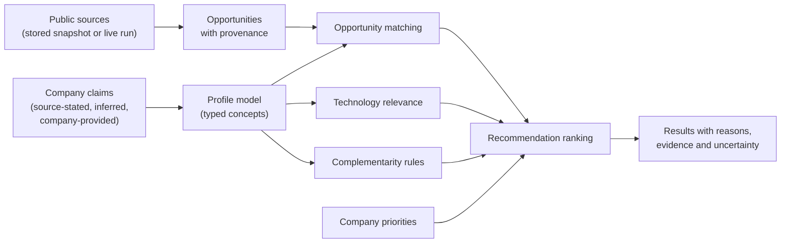
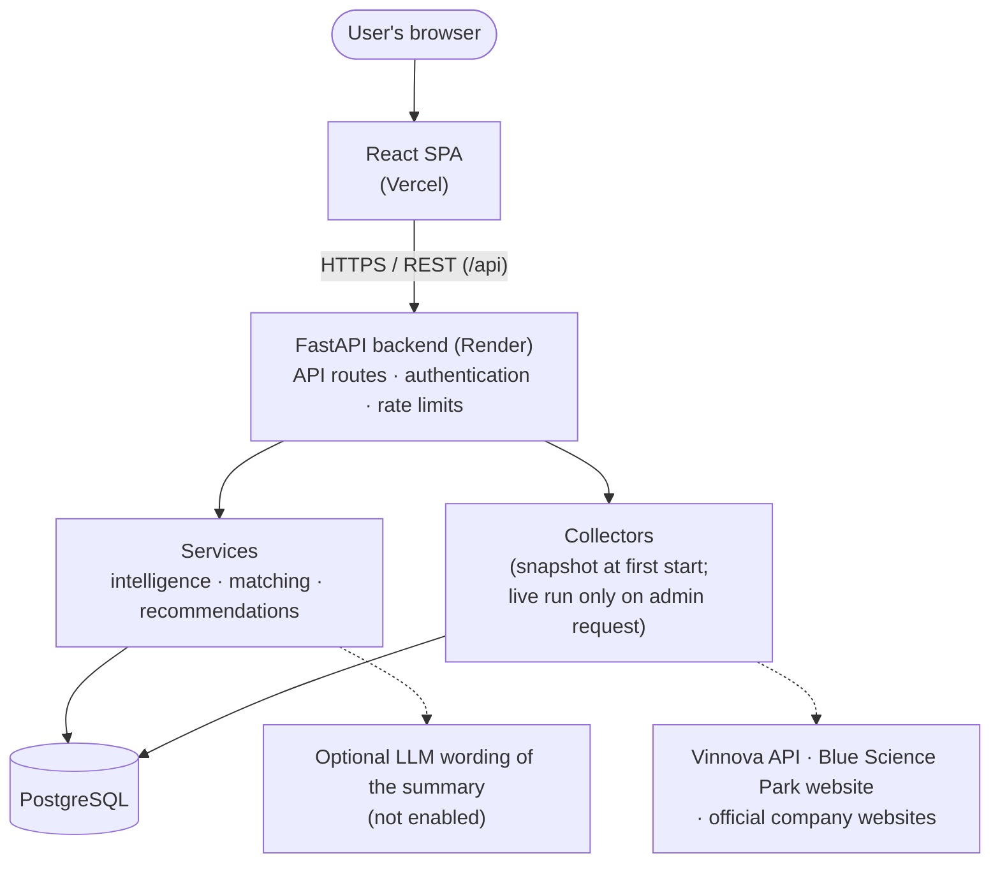

# Virtual Science Park

**From scattered innovation information to evidence-backed opportunities and meaningful connections.**

Virtual Science Park (VSP) turns fragmented information about companies, technologies, funding calls and regional innovation resources into **company-specific, explainable recommendations**. For each company it shows which funding and programmes fit, which technologies deserve attention and which organisations could complement it, and why, with the evidence and the uncertainty behind every result.

### [▶ Open the live demo](https://virtualsciencepark.vercel.app)

| | |
|---|---|
| **Live demo** | https://virtualsciencepark.vercel.app |
| **API documentation** | https://virtual-science-park.onrender.com/api/docs |
| **Backend health** | https://virtual-science-park.onrender.com/api/health |
| **Repository** | https://github.com/Shameendudekula/virtual-science-park (submitted branch: [`deploy/render-demo`](https://github.com/Shameendudekula/virtual-science-park/tree/deploy/render-demo)) |


| Hackathon | |
|---|---|
| Event | Hackathon 2026 (campor × BUILD) |
| Dates | 13–15 November 2026 |
| Venue | Black Box, Ericsson, Karlskrona, Sweden |
| Challenge | Virtual Science Park, set by Blue Science Park |
| Team | A solo student developer from Blekinge Institute of Technology |

> **Status: working hackathon prototype.** The application runs end to end and is deployed. Its data is a dated snapshot (13 November 2026), its matching is deterministic, and some requirements of the challenge brief are not yet implemented. See [Current limitations](#current-limitations). VSP is an independent project; it is not affiliated with or endorsed by Blue Science Park or the other organisations whose public data it displays.

---

## In 30 seconds

- **Problem:** information that matters to a small innovative company (funding calls, test environments, potential partners, ecosystem news) is spread across many sources, and nobody has time to watch them all.
- **Who benefits:** small and medium-sized companies in a science-park ecosystem, and the people who support them.
- **What is different:** VSP is not a directory or a keyword search. It builds a profile of each company from documented claims, matches opportunities and partners against that profile with transparent rules, and ranks concrete next steps for that company.
- **Why you can trust the results:** every score is built from the criteria and penalties shown next to it; every source-stated fact links to its source with a retrieval date; inferences are labelled as inferences; partners are labelled "potential"; VSP does not assess eligibility.
- **Try it:** open the [live demo](https://virtualsciencepark.vercel.app) and choose a demonstration company. Demo sessions are read-only.

## The challenge

> "How can AI agents help companies discover relevant knowledge, connections and opportunities based on an understanding of their business?" (Blue Science Park challenge brief, p.1)

Blue Science Park wants a Virtual Science Park: a service that understands its 40+ member companies and finds relevant knowledge, events, testing environments, funding and partners for them. The brief's requirements are summarised in [docs/research/challenge-analysis.md](docs/research/challenge-analysis.md) and tracked in [docs/requirements.md](docs/requirements.md).

## The problem

An innovation ecosystem holds valuable information, but it is fragmented:

- company capabilities and technologies, on each company's own website;
- funding programmes and application calls, each with its own deadline and conditions;
- testing environments and facilities;
- potential research and industry collaborators;
- regional programmes, events and ecosystem news.

A 15-person company rarely has the time to monitor all of these sources, or the context to judge which items actually matter to it. VSP connects these pieces into one discovery experience centred on a single company: *what fits us, why, and what should we do next?*

---

## What Virtual Science Park does

### Company Intelligence
- **Value:** a company sees what VSP "knows" about it, and can correct it.
- **How:** each profile is a set of typed claims (products, technologies, capabilities, industries, research interests, documented collaborations). Every **source-stated** claim quotes the official web page it comes from, with a link and retrieval date. **Inferred** interests come from documented rules (each shows its rule and the facts it was derived from), and **company-provided** information is labelled separately. With a password sign-in, the company can confirm, reject, correct or add claims. Source-stated claims cannot be edited in place (an ORM guard enforces this); a correction is stored as a company-provided claim that supersedes the original, which stays visible.

### Opportunity Radar
- **Value:** funding calls, programmes, test environments and events ranked for this company, not a generic list.
- **How:** each opportunity gets a 0–100 relevance score built from technology, industry and capability fit, the company's priorities, timeliness, regional relevance and evidence availability, with every criterion shown. Views: ranked cards, a regional map, a deadline timeline, a funding list sorted by application deadline, and an events list. Deadlines are only shown when the source states them; closed and undated calls are labelled as such. **VSP does not assess eligibility:** where the source contains eligibility text, it is quoted.

### Technology Radar
- **Value:** which technologies deserve this company's attention, and why.
- **How:** technologies are placed in **Adopt, Trial, Assess or Monitor** rings by explicit rules (for example, *Adopt* requires a documented capability link, open relevant opportunities and a score of at least 55). The rings are **recommendations of attention, not maturity assessments**: technology maturity is shown as "not assessed". Applications and benefits are labelled as hypotheses.

### Collaboration Graph
- **Value:** organisations that could complement the company, with a concrete reason and a sensible first step.
- **How:** a suggestion requires a **documented need on one side and a documented capability on the other** (for example, offshore structures that must operate in harsh conditions ↔ certified cable and pipe sealing). By design, shared keywords alone do not create a suggestion. The default view is a list of recommended partners (what they offer, why it is relevant, potential mutual benefit, suggested first step, evidence and uncertainties); an optional graph lets users explore the wider ecosystem. **Every suggestion is labelled as a potential collaboration, never as an existing or agreed partnership,** and VSP does not predict whether a collaboration will happen or succeed.

### Recommendations
- **Value:** a short, prioritised list of next steps: apply for a call, develop a research proposal, investigate a test environment, contact a potential partner, explore a technology or consider a joint application.
- **How:** candidates from all the analyses above are ranked with visible criteria and placed in *High priority*, *Medium priority* or *Explore later* tiers. Each one shows what, why, the related capability, the potential value, the evidence, the uncertainty and the next step. The company's **priorities** (for example *Find new funding* or *Find testing facilities*) change the ranking, and every change returns a **ranking diff** showing what moved up or down. A "Your Opportunities" page highlights the top three actions, upcoming deadlines and nearby partners; an **Overview** suggests concrete next steps; an **Innovation brief** can be exported as a PDF.

### Ask VSP
- **Value:** ask a discovery question in plain language and get matching records.
- **How:** every question is first checked by **deterministic boundary rules**:
  - supported questions (funding, testing, technology, partners, events, business development) are answered by **structured search** over the VSP database: ranked records with their reasons, not generated text;
  - eligibility questions can return potential matches, with a notice that VSP does not determine formal eligibility or guarantee funding;
  - requests that need a person (decisions, commitments, professional advice) are referred to Blue Science Park staff through its official website;
  - unrelated requests, attempts to override the service's rules and requests for private company data are declined with a fixed explanation.

  **Ask VSP is not a generative AI chatbot and not an autonomous agent.** No LLM is used.

### Company Workspaces
- **Value:** each company works in its own space; its edits and priorities stay private.
- **How:** one login per company. A company's results use its *private* profile (including its own edits), while other companies only ever see its *public* profile (source facts and inferences). Private edits, priorities, saved items and question history are kept out of other companies' results; the backend enforces this, and an automated isolation test covers it.

---

## How Virtual Science Park works

1. **Choose a workspace.** A visitor opens a demonstration company (read-only), or a company signs in with its own password.
2. **Build the profile.** VSP builds the company's intelligence profile from its documented claims: curated, evidence-backed seed data plus any company-provided corrections.
3. **Extract concepts.** Technologies, industries and capabilities (and the company's needs) are extracted from those claims as typed concepts.
4. **Collect public information.** Funding calls and ecosystem listings are stored with their source link, retrieval date and provenance (*snapshot* or *live*).
5. **Match opportunities.** The matching engine scores every opportunity's relevance to the company, criterion by criterion.
6. **Find complementary partners.** Complementarity rules pair documented needs with documented capabilities across companies.
7. **Rank next steps.** Recommendation logic combines opportunities, technologies and partners into ranked, tiered actions.
8. **Explain.** The interface shows each result with its reasons, evidence, uncertainty and a suggested next step.
9. **Adjust.** Changing the company's priorities recomputes everything and shows how the ranking changed.



---

## The intelligence behind the recommendations

All matching and ranking is **deterministic and explainable**: the same data and priorities produce the same ranking (there is no randomness or model sampling), and each score in the interface is built from the criteria and penalties shown next to it (the caps that apply are described below). **Scores are heuristics for prioritisation, not probabilities.** Full detail: [docs/vsp/matching-methodology.md](docs/vsp/matching-methodology.md).

| Building block | How it works |
|---|---|
| **Typed concepts** | A taxonomy of 18 technologies, 15 industries and 22 capabilities, each with English and Swedish terms and a specificity weight. Generic words ("innovation", "sustainable", "system") are deliberately *not* concepts, so sharing them never creates relevance. |
| **Claim types** | Concept strength depends on where it comes from: source-stated 1.0, company-provided 0.9, confirmed inference 0.9, unconfirmed inference 0.5; rejected or outdated claims count 0. Interests never count as capabilities. |
| **Opportunity relevance** (0–100) | Seven criteria with these maximum values: technology fit (35), industry fit (20), capability and need fit (15), priority alignment (15), timeliness (10), regional relevance (10) and evidence availability (5). Their maxima add up to 110; the scores are **not normalised**. The criteria are added, a *domain mismatch* penalty (−25, or −10 when there is also a topical match) is subtracted when a call targets an industry the company does not work in, the total is capped at 30 when only broad overlap matches and at 10 for closed calls, and the result is clipped to the 0–100 range and rounded. 35 is the "relevant" threshold. |
| **Evidence quality and eligibility** | Reported separately and never merged into the score. Eligibility is always "not assessed by VSP", with the source text quoted when present. |
| **Technology relevance** | Documented capability, capability adjacency, recorded interest, industry relevance and opportunity momentum, mapped to Adopt / Trial / Assess / Monitor by explicit rules. |
| **Capability complementarity** | A collaboration score requires at least one fired need ↔ capability rule; shared context, joint open opportunities and regional proximity add to it. Similar companies with no fired rule get no suggestion. |
| **Regional relevance** | Karlskrona ⊂ Blekinge ⊂ Sweden ⊂ Europe, plus International and Online, each with a *stated* or *inferred* basis. Online events and national or European funding are not penalised. Proximity is gated by topical fit, so it does not substitute for relevance. |
| **Regional scope of events** | Blue Science Park event listings contain no venue. Their scope comes from a place name in the listing text, or, when there is none, is **inferred from the publisher** (Blue Science Park, Karlskrona) and labelled *inferred*. This is not a confirmed venue: an inferred Blekinge location has a base regional value of 7 instead of 9, and the event format is shown as "not stated" unless the listing mentions online or hybrid participation. |
| **Timeliness** | Open (10), upcoming (8), closing soon (7), no deadline (4), placeholder date rejected (3), closed (0). Events have no collected date: a recently listed event scores 4, an older listing 0 and is not recommended. Placeholder dates in the source are never shown as deadlines. |
| **Recommendation ranking** (0–100) | Stage relevance (40) + priority alignment (25) + urgency (15) + evidence strength (10) + actionability (10), which adds up to 100, minus 12 when the recommendation's main priority is switched off (never below 0). *High priority* also requires enough evidence and must not rest only on unconfirmed inferences. |

---

## Architecture and technology stack

VSP is a **modular monolith**: one React single-page app, one FastAPI service and one PostgreSQL database, communicating over HTTP/REST. It is not a microservice system.



| Layer | Technology (versions from the project files) |
|---|---|
| Frontend | React 19, TypeScript 5.8, Vite 6, Tailwind CSS 4, React Router 7, TanStack Query 5, React Flow (`@xyflow/react`) for the graph, Recharts |
| Backend | Python 3.12, FastAPI, Pydantic 2, SQLAlchemy 2.0, Psycopg 3, httpx, ReportLab (PDF brief) |
| Database and migrations | PostgreSQL, Alembic |
| Testing | pytest, Vitest and Testing Library, TypeScript typecheck, production build |
| Deployment | Frontend on Vercel, backend on Render (the repository includes a `backend/Dockerfile` and entrypoint that apply migrations and start the API) |

**Backend modules** (`backend/app`): `api/routes` (authentication, company-scoped endpoints, opportunities, search, sources, health) · `security` (signed sessions, permissions, admin token, rate limits, an outbound HTTP client with SSRF checks) · `services/collectors` (source registry and collectors) · `services/intelligence` (taxonomy, profiles, enrichment, search, Ask VSP boundaries, views and PDF) · `services/matching` (opportunity, technology and complementarity matching) · `services/recommendations` (ranking and the recompute pipeline) · `services/llm` (the optional, disabled wording step) · `core/db_safety` (database guards). Details: [docs/vsp/architecture.md](docs/vsp/architecture.md).

---

## Data sources and current dataset

All bundled data was collected on **13 November 2026** and is loaded as a dated snapshot when the database is first seeded. **Nothing is synchronised continuously:** an administrator can start a new collection from the Data Sources page (admin token required). Every record keeps its source link, retrieval date and a provenance label: *Collected snapshot*, or *Live data* only after a live run.

| Source | What it contributes | Raw listings in the bundled snapshot |
|---|---|---|
| [Vinnova open-data API](https://data.vinnova.se/api/) | Funding opportunities: application rounds with titles, deadlines and call texts where stated. Contact persons are not collected. | 56 application rounds (plus 44 calls, used for programme names) |
| [Blue Science Park website](https://www.bluesciencepark.se/) (public WordPress API) | The member directory (used to verify membership), plus news and event listings. Used as **metadata only** (title, publication date, link), because reuse rights were not confirmed. Event dates, venues, organisers and sponsors are not in the collected data. | 56 member listings, 100 news posts, 50 event listings |
| Official company websites | Short quoted excerpts supporting each source-stated claim in the detailed profiles. An admin-only check can re-fetch the pages to confirm each excerpt is still present. | Evidence for 7 profiled organisations |

Ymner is shown as an external link only (its API requires authentication), and the EU Funding & Tenders Portal is a disabled placeholder; neither contributes data. Details: [docs/vsp/data-sources.md](docs/vsp/data-sources.md).

**Records in the deployed database** (from the 13 November 2026 snapshot, as reported by the [health endpoint](https://virtual-science-park.onrender.com/api/health) on 14 November 2026; not real-time counts):

| Measure | Count |
|---|---:|
| Profiled companies (detailed, evidence-backed profiles) | 7 |
| Directory-only companies | 49 |
| Opportunities (Vinnova rounds plus Blue Science Park news and event listings) | 206 |
| Evidence records | 341 |

The raw listings above are what the sources returned (for example, 56 member listings); the counts in this table are what the deployed application holds. They measure different things and should not be compared one to one.

---

## Deployment

| Component | Where | Link |
|---|---|---|
| Frontend | Vercel | https://virtualsciencepark.vercel.app |
| Backend API | Render | https://virtual-science-park.onrender.com |
| API documentation | Render (FastAPI) | https://virtual-science-park.onrender.com/api/docs |
| Health | Render | https://virtual-science-park.onrender.com/api/health |

**Spot checks of the deployment (14 November 2026, direct HTTP requests):**

- The live demo, API documentation, health endpoint and repository page each returned HTTP 200.
- The health endpoint reported a working database, demo mode on, the LLM disabled and the record counts listed under [Data sources and current dataset](#data-sources-and-current-dataset).
- A demo sign-in returned a session marked read-only.
- An unrelated Ask VSP question ("Write a romantic poem.") was declined with no results.

These checks did not change any data. They are not an automated end-to-end test suite and not an independent security certification. This is a hackathon prototype, not a production-grade service.

---

## Security and privacy

Access to private company data and every change are checked by the **backend**. Disabled buttons in the interface are only a convenience; they are not the security boundary. Details: [docs/vsp/security.md](docs/vsp/security.md).

- **Read-only public demo.** With demo mode on, anyone can open a demonstration company workspace without a password and explore every page; every change is refused by the API (HTTP 403).
- **Own company only.** Signing in with a company's username and password allows editing that company's profile, priorities and saved items. Another company's private data or edits are refused (403).
- **Admin-only operations.** Running data collectors and resetting the demo require the admin token, also in demo mode. A company session never grants admin rights.
- **Signed sessions.** Sessions are HMAC-signed tokens with an expiry; forged, modified or malformed tokens are refused (401). Passwords are stored as PBKDF2 hashes.
- **Rate limits** on sign-in, demo sign-in, changes, search, the innovation brief, collectors and reset.
- **Outbound request checks.** Collectors use an HTTP client that only allows HTTPS to each source's allowlisted hosts, rejects private and loopback addresses, re-validates redirects and limits response size and time. These are SSRF mitigations, not an independently tested guarantee.
- **Search privacy.** Questions asked in a demo session are not stored, and demo sessions cannot read question history. History recorded before this rule existed (which may include earlier demo visitors' questions) has **not** been deleted and may be visible to the company account owner; the demo reset does not clear it.

**Known security caveats** (not fixed, and no complete security audit has been performed):

- **Protected databases.** Project policy treats `vsp`, `vsp_test`, `vsp_park` and `vsp_park_test` as protected. The current code still accepts `vsp_park` and `vsp_park_test` as built-in database names; the database-safety refactor is **pending**.
- **Rate limiting behind a proxy.** Limits are counted per client IP in memory. Behind Render's reverse proxy, visitors may share one IP bucket; this has not been verified.

---

## Testing and verification

**Previously verified local results** (no database used; recorded during the final local verification and **not re-run for this README revision**):

| Check | Result |
|---|---|
| Backend tests, no-database mode (`VSP_TEST_NO_DB=1`) | 237 passed, 78 skipped (the skipped tests need a database) |
| Frontend tests (Vitest) | 49 passed |
| TypeScript typecheck | Passed |
| Frontend production build | Passed |

The database-backed backend suite was **not** part of that verification and has not been run for this README revision. An earlier run, before the final frontend and documentation changes, passed 314 tests with 1 skipped against a separate, isolated test database. Running it again requires a separately verified, isolated database environment (see [Tests and build](#tests-and-build)).

Local automated tests and the spot checks of the deployment (see [Deployment](#deployment)) are separate: no automated end-to-end tests run against the deployment.

---

## Product walkthrough

> **Screenshots: to be added.** The repository does not yet contain product screenshots. Suggested set: landing page, Company Intelligence, Opportunity Radar, Technology Radar, Collaboration Graph, Recommendations and Ask VSP. Until then, the [live demo](https://virtualsciencepark.vercel.app) and the [five-minute demo guide](docs/vsp/demo-guide.md) show the same journey.

---

## Run it locally

**Prerequisites:** Python 3.12, Node 20+, PostgreSQL 14+, and a **dedicated PostgreSQL database for this app that you create and own**. It must not be one of the protected databases: `vsp`, `vsp_test`, `vsp_park` or `vsp_park_test`.

> **Database-safety refactor pending.** Project policy treats `vsp`, `vsp_test`, `vsp_park` and `vsp_park_test` as protected: never use them for development, tests or schema changes. The code does not fully enforce this policy yet. It always refuses `vsp` and `vsp_test`, but still accepts `vsp_park` (application) and `vsp_park_test` (tests) as built-in names, and `.env.example` and Docker Compose still default to `vsp_park`. Until the refactor is done, do not rely on any default: configure your dedicated database explicitly as shown below.

```bash
# 1. Configuration
cp .env.example .env
# Edit .env before starting anything:
#   DATABASE_URL        -> your dedicated database (the example value points at vsp_park: change it)
#   VSP_ALLOW_DATABASE  -> the name of that database (any other name is refused without this opt-in)
#   replace every change-me value before sharing the app

# 2. Backend
cd backend
python3.12 -m venv .venv && source .venv/bin/activate
pip install -e ".[dev]"
alembic upgrade head              # creates the tables in the database named in DATABASE_URL
uvicorn app.main:app --port 8000  # seeds that database on first start

# 3. Frontend (new terminal)
cd frontend
npm ci
npm run dev
```

| What | URL |
|---|---|
| Application | http://localhost:5173 |
| API | http://localhost:8000/api |
| API documentation | http://localhost:8000/api/docs |

**Sign in:** each company has one workspace login (username = company slug, e.g. `ocean-harvesting`; password = `DEMO_COMPANY_PASSWORD` from `.env`). A password sign-in can edit its own company's profile, priorities and saved items. With `DEMO_MODE=true` the login page also offers password-free demo workspaces; these are **read-only** (every page can be explored, nothing can be changed). Resetting the demo and running collectors need the admin token (`ADMIN_TOKEN`).

**Docker (written, not yet executed):** Docker Compose currently creates and uses a database named `vsp_park` unless `.env` sets `POSTGRES_DB` (and a matching `VSP_ALLOW_DATABASE`) to a dedicated name. Under the project policy that default is protected, so do not run it unchanged; the Compose setup is part of the pending database-safety refactor.

### Tests and build

**No-database tests** (no PostgreSQL needed): database fixtures are skipped and the test URL points at a closed local port, so no connection is made.

```bash
cd backend && VSP_TEST_NO_DB=1 pytest
cd frontend && npm test && npm run build
```

**Full database-backed tests: do not run them yet.** They drop and recreate the `public` schema of the target database (then apply the Alembic migrations and seed it). `vsp_park_test` is a protected database and must never be used, but the current code still accepts it as a built-in test database name (it is even the suite's default when `TEST_DATABASE_URL` is unset). The database-safety refactor that removes this is pending. Until that refactor is complete **and** a dedicated, verified, isolated test database is explicitly configured, do not run the database-backed suite. Never point it at `vsp`, `vsp_test`, `vsp_park` or `vsp_park_test`.

For reference, `backend/tests/conftest.py` already checks these settings before anything connects and aborts with exit code 4 if one fails:

| Variable | Requirement |
|---|---|
| `TEST_DATABASE_URL` | Names the isolated test database and states its port explicitly |
| `VSP_ALLOW_TEST_DATABASE` | The name of that database; must end with `_test` and can never be a protected database |
| `VSP_TEST_EXPECTED_PORT` | Must equal the port in `TEST_DATABASE_URL` |
| `VSP_TEST_EXPECTED_SYSTEM_ID` | Optional: the server's system identifier; any connection to a different server is refused |

Every connection, and the schema reset itself, re-checks the database name, port and (if given) system identifier; see [docs/vsp/security.md](docs/vsp/security.md#database-and-configuration-safety). These checks do not yet treat `vsp_park_test` as protected.

### Configuration

All settings are in [.env.example](.env.example). The ones you are most likely to change:

| Variable | Purpose |
|---|---|
| `DATABASE_URL` | PostgreSQL connection to your dedicated database (Docker Compose sets its own). `vsp`, `vsp_test` and system databases are always refused. The code still accepts `vsp_park` and `vsp_park_test` without an opt-in, but project policy treats them as protected (refactor pending), so never point it at them |
| `VSP_ALLOW_DATABASE` | Explicit opt-in naming your dedicated database (required for any name other than the built-in ones; can never allow `vsp` or `vsp_test`) |
| `ENVIRONMENT` | `development`, `test` or `production`. Production refuses demo mode, weak or placeholder secrets and the `vsp:vsp` database credentials |
| `SECRET_KEY` | Signs workspace sessions. If empty, a random key is generated at each start |
| `ADMIN_TOKEN` | Required to run collectors and to reset the demo (`X-Admin-Token` header), also in demo mode |
| `DEMO_COMPANY_PASSWORD` | Password for the seeded company accounts |
| `DEMO_MODE` | Password-free, read-only demo login. Off by default; `.env.example` turns it on for the local demo. Refused in production |
| `REFERENCE_DATE` | Pins "today" for a reproducible demo |
| `LLM_PROVIDER`, `LLM_MODEL`, `LLM_API_KEY` | Optional summary rewording (`anthropic`; needs `pip install ".[llm]"`). Disabled in the demo configuration |

---

## Current limitations

- **Ask VSP** uses deterministic, keyword-based boundary rules and structured search, not a conversational LLM. Unusual wording can be misclassified, vague requests are declined rather than answered with a clarifying question, and each message is checked on its own (no conversation memory).
- **Company profiles are curated.** The 7 detailed profiles are evidence-backed seed files whose quotes were checked against the official pages when collected; pages can change afterwards. No runtime agent fetches and builds profiles yet. The other 49 directory companies have no detailed profile.
- **Parts of the challenge brief are incomplete:** the brief's six claim categories and per-claim priority flag, event audience and dates, "what changed" summaries for updates, the exact "Potential match — eligibility not assessed" label, a banned-phrase check and a persistent prototype banner are missing or only partly implemented.
- **Dated snapshot.** Bundled data was collected on 13 November 2026 and is only refreshed when an administrator runs a collection.
- **Events are metadata only:** no confirmed dates, venues, organisers or sponsors. An event's regional scope is inferred (from the listing text or the publisher), not a confirmed location.
- **Eligibility is not assessed;** only the source's own text is quoted. A listed or highly ranked opportunity does not mean a company is eligible or will receive funding.
- **Collaboration outcomes are not guaranteed.** Suggested partners are possibilities based on documented capabilities, not predictions or agreements.
- **Scores are heuristics** for prioritisation, not probabilities or predictions.
- **Database safety:** the protected-database refactor is pending (see [Security and privacy](#security-and-privacy)), and the migrations reuse the revision IDs `0001` and `0002` from an earlier prototype's different schema.
- **Other:** no Python dependency lock file yet; Docker Compose has not been run; Ymner is linked, not integrated.

## Future roadmap

*Planned directions. None of these is implemented yet.*

- Runtime company-profile enrichment from official websites, with the same evidence and review rules.
- More robust semantic retrieval alongside the deterministic rules, keeping every result explainable.
- Better coverage of events (dates, venues, audience) and testing facilities from verified sources.
- Additional verified data-source integrations (for example EU funding).
- Richer explanations and feedback-driven ranking.
- Improved company onboarding and feedback loops.
- Evaluation with real users and domain experts.
- Completing the database-safety refactor.

---

## Documentation

**The running application** (`docs/vsp/`):

| Document | Contents |
|---|---|
| [architecture.md](docs/vsp/architecture.md) | Modules, data model, recompute pipeline |
| [data-sources.md](docs/vsp/data-sources.md) | Sources, provenance, validation rules, Ymner findings |
| [matching-methodology.md](docs/vsp/matching-methodology.md) | Scoring criteria, regional relevance, recommendation tiers |
| [security.md](docs/vsp/security.md) | Authentication, isolation, outbound-request protection, data quality |
| [testing.md](docs/vsp/testing.md) | Test suites and what they cover |
| [demo-guide.md](docs/vsp/demo-guide.md) | Five-minute demo script |

**Project planning and requirements** (`docs/`): these were written before implementation. Some describe an earlier, unimplemented design and have not been updated. In particular, [architecture.md](docs/architecture.md), [api-contract.md](docs/api-contract.md), [testing.md](docs/testing.md), [handover.md](docs/handover.md) and [solution-overview.md](docs/solution-overview.md) do not describe the running application.

| Document | Purpose |
|---|---|
| [requirements.md](docs/requirements.md) | Official and team requirements, priorities, open questions |
| [research/challenge-analysis.md](docs/research/challenge-analysis.md) | The official brief with page references |
| [research/use-cases.md](docs/research/use-cases.md) | Actors, journey, use cases |
| [decisions.md](docs/decisions.md) | Decision log (some decisions differ from the implementation, e.g. D-007 SQLite and D-012 simulated sign-in) |
| [security-privacy.md](docs/security-privacy.md) | Planned security, privacy and interaction boundaries |
| [sources.md](docs/sources.md) | Source register |
| [design/](docs/design/) | Product vision, information architecture, screens, design system |
| [quality-boundary-check.md](docs/quality-boundary-check.md), [pitch-outline.md](docs/pitch-outline.md), [team-roles.md](docs/team-roles.md) | Deliverable drafts and roles |

## Data and licensing

Vinnova data comes from its public open-data API, with attribution and links; contact persons are not collected. Blue Science Park content is used as metadata only, because reuse rights were not confirmed. Company facts are short, attributed excerpts that support specific claims. This is a hackathon prototype, not affiliated with or endorsed by the organisations whose public data it displays.
