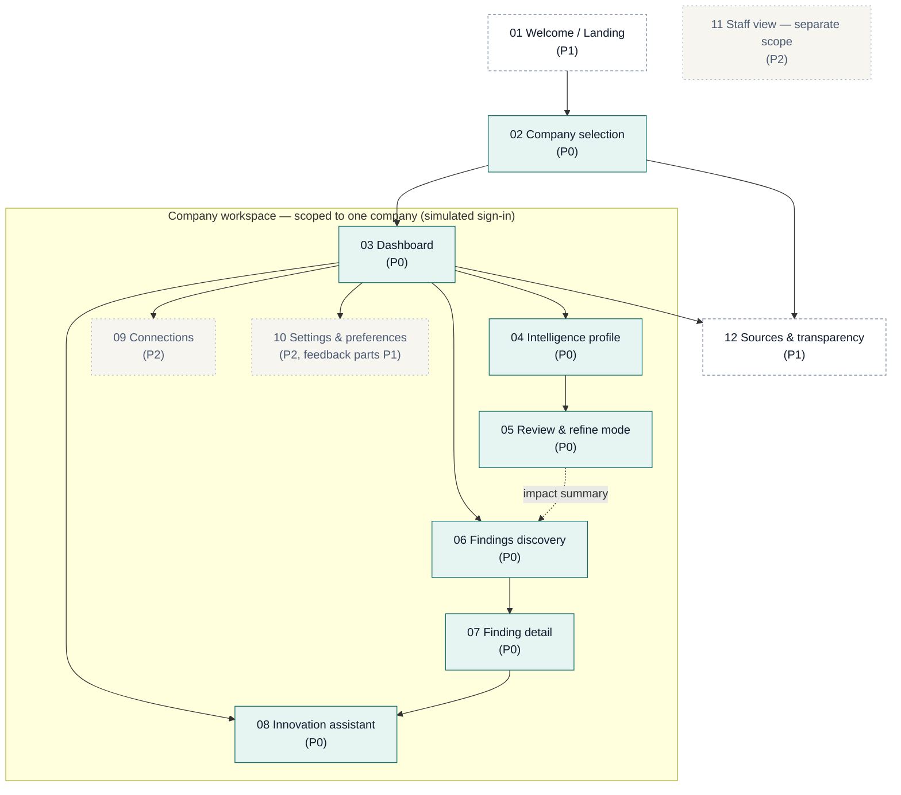
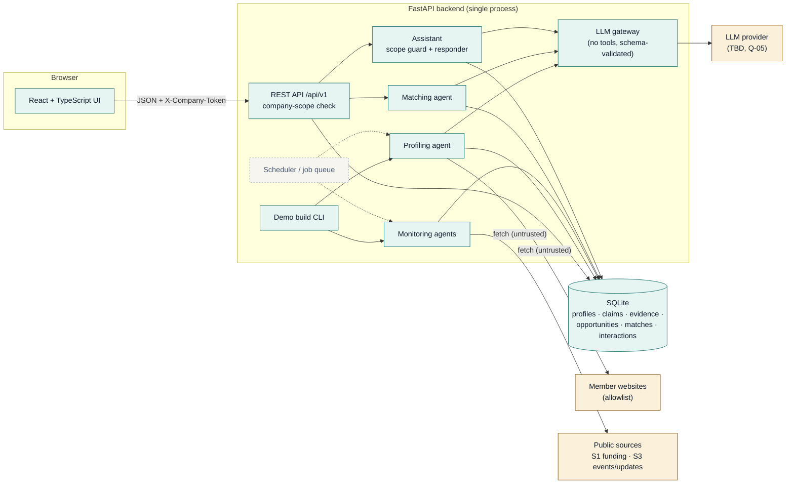

# Information Architecture

**Status:** Proposal. Routes and navigation are design proposals; API endpoints are taken unchanged from [../api-contract.md](../api-contract.md). No new endpoints are introduced. Where the UI needs something the API does not offer, it is marked **Gap** and listed in [design-decisions.md](design-decisions.md#still-pending) and [api-ui-consistency.md](api-ui-consistency.md).

## A. Sitemap



Legend: solid teal = **P0** (MVP); dashed = **P1**; dotted grey = **P2** (future, design only).

## Routes (proposal)

| # | Screen | Route | Data (existing endpoints) | Priority |
|---|---|---|---|---|
| 01 | Welcome / landing | `/` (P1). In P0, `/` redirects to `/companies` | Static | P1 |
| 02 | Company selection | `/companies` | `GET /companies` | P0 |
| 03 | Dashboard | `/c/:companyId` | `GET /companies/{id}`, `GET /companies/{id}/profile`, `GET /companies/{id}/matches?limit=…` | P0 |
| 04 | Intelligence profile | `/c/:companyId/profile` | `GET /companies/{id}/profile` | P0 |
| 05 | Refine (part of 04; no separate mode, DD-09) | `/c/:companyId/profile` | `PATCH …/profile/claims/{claim_id}`, `POST …/profile/claims`, then `GET …/matches` | P0 |
| 06 | Findings discovery | `/c/:companyId/findings?type=funding\|event\|update` | `GET /companies/{id}/matches?type=` | P0 |
| 07 | Finding detail | `/c/:companyId/findings/:matchId` | The match from the cached `GET …/matches` response (**Gap:** no `GET /matches/{id}`; see [DD-12](design-decisions.md)) | P0 |
| 08 | Innovation assistant | `/c/:companyId/assistant` | `POST /companies/{id}/ask` | P0 |
| 09 | Connections | `/c/:companyId/connections` | None (FR-M12 is P2; no endpoint) | P2 |
| 10 | Settings & preferences | `/c/:companyId/settings` | Feedback and saved items: P1 endpoints; others none | P2 (P1 parts) |
| 11 | Staff view | `/staff` (separate scope) | None (FR-U12 is P2; no endpoint) | P2 |
| 12 | Sources & transparency | `/about` | Static content from [../sources.md](../sources.md); `GET /sources` is P1 | P1 |

## Navigation Model

- **Global (outside a workspace):** a slim top bar with the product wordmark and an "About this prototype" link (P1). Company selection is the entry point.
- **Workspace shell (inside `/c/:companyId`):**
  - **Left sidebar (240 px, navy; replaced by a top tab bar ≤ 900 px):**
    - Dashboard
    - Profile
    - Findings, with sub-items Funding · Events · Updates
    - Assistant
    - Below a divider, *Future*: Connections and Settings. In P0 these are hidden; in the clickable prototype they are shown disabled with a "Planned" chip.
  - **Top bar:**
    - company switcher, labelled "Acting as: {Company} · Simulated sign-in" (FR-U01, FR-S06);
    - "Ask the assistant" shortcut;
    - profile review status chip.
  - **Prototype banner** (always visible, FR-U07): "Prototype · Opportunity data is a dated snapshot · Sign-in is simulated · [What's real?]"
- **Breadcrumbs** on the detail and review screens only.
- **Switching company** resets workspace state and clears the assistant panel, so no cross-company context is left on screen (BR-19).

## Content Hierarchy per Workspace

```text
Company
├── Profile (version, last researched date, missing_fields)
│   └── Claims grouped by the brief's categories (p.2)
│       └── Evidence (quote, source link, retrieved date)
├── Findings (matches)
│   ├── Funding   — purpose, deadline, eligibility summary, potential-match label
│   ├── Events    — format, audience, dates, location
│   └── Updates   — published date, what changed
│       └── each: why it matches (cited claims), next step, uncertainties, source, data status, disclaimer
└── Assistant (private to this company)
```

## F. Data Flow (frontend ↔ backend ↔ agents ↔ sources ↔ database)



- **MVP:** solid boxes. Profiling and collection run from the CLI; matching and the assistant are served through the API.
- **Future:** dashed boxes (scheduler, P2).
- **Untrusted inputs:** amber boxes.

The browser never calls sources or the LLM directly ([../architecture.md](../architecture.md#frontend-and-backend-responsibilities)).
